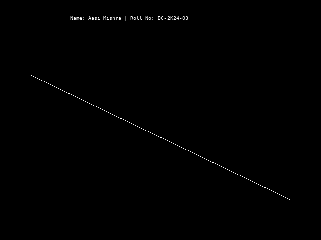

# Computer Graphics and Multimedia Lab – Assignment 1

This folder contains the implementation of the **Digital Differential Analyzer (DDA) Line Drawing Algorithm** using C++ and the `graphics.h` graphics library.

## Student Information

| Detail | Information |
|---|---|
| **Name** | Aasi Mishra |
| **Roll Number** | IC-2K24-03 |
| **Course** | Integrated MCA |
| **Subject** | Computer Graphics and Multimedia (CGMM) |
| **Lab** | Lab 1 |

## Assignment Details

**Question:** Write a C/C++ program using a graphics library or tool to implement the Digital Differential Analyzer (DDA) Line Drawing Algorithm to draw a straight line between two given points.

### Objective

To understand and implement the DDA line drawing algorithm, which is used in computer graphics to generate a straight line between two endpoints by calculating intermediate pixel positions.

## Files Included

| File | Description |
|---|---|
| `cgmmlabaasgnBasicShape.cpp` | C++ implementation of the DDA Line Drawing Algorithm |
| `dda_line_output.png` | Output screenshot showing the generated line |

## Algorithm: DDA Line Drawing

The DDA algorithm calculates intermediate points between two endpoints using incremental values of X and Y coordinates.

### Steps

1. Take the starting point `(x1, y1)` and ending point `(x2, y2)`.
2. Calculate the differences:
   - `dx = x2 - x1`
   - `dy = y2 - y1`
3. Calculate the number of steps:
   - `steps = max(|dx|, |dy|)`
4. Calculate the increments:
   - `xIncrement = dx / steps`
   - `yIncrement = dy / steps`
5. Start from the initial coordinates.
6. Plot each pixel using the rounded X and Y coordinates.
7. Increment X and Y until the endpoint is reached.

### Formula

```text
dx = x2 - x1
dy = y2 - y1

steps = max(|dx|, |dy|)

X_increment = dx / steps
Y_increment = dy / steps
```

## Sample Coordinates

The program uses the following coordinates:

| Parameter | Value |
|---|---|
| Starting Point | (60, 150) |
| Ending Point | (580, 400) |
| Line Color | White |

## Output

The program displays a straight line between the specified starting and ending points using the DDA algorithm.



## Technologies Used

- **Programming Language:** C++
- **Graphics Library:** `graphics.h`
- **Header Files:** `conio.h`, `stdio.h`, `stdlib.h`, `math.h`
- **Concepts:** Computer Graphics, Pixel Plotting, Line Drawing Algorithms

## Learning Outcomes

After completing this assignment, I learned:

- The fundamentals of line drawing in computer graphics.
- How the DDA algorithm calculates intermediate pixel positions.
- How to use incremental calculations for plotting pixels.
- How to implement graphics operations using the `graphics.h` library.
- How coordinate systems are used to draw graphical objects.

---

**Submitted by:** Aasi Mishra  
**Roll Number:** IC-2K24-03
