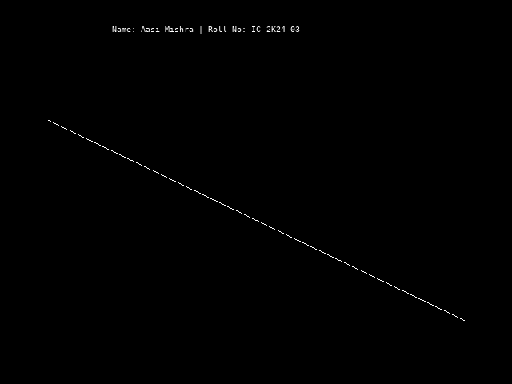

# Computer Graphics and Multimedia Lab

This repository contains practical assignments and C++ programs completed as part of the **Computer Graphics and Multimedia (CGMM) Lab** for the Integrated MCA course.

The repository focuses on understanding fundamental computer graphics concepts and implementing graphics algorithms using C++ and the `graphics.h` library.

## Student Information

| Detail | Information |
|---|---|
| **Name** | Aasi Mishra |
| **Roll Number** | IC-2K24-03 |
| **Course** | Integrated MCA |
| **Subject** | Computer Graphics and Multimedia |
| **Programming Language** | C++ |

## Repository Structure

```text
CGMMLabAssignmentIC-2K24-03/
│
├── Lab1/
│   ├── README.md
│   ├── cgmmlabaasgnBasicShape.cpp
│   └── dda_line_output.png
│
├── Lab2/
│   ├── README.md
│   └── dda_line.cpp
│
└── README.md
```

## Lab Assignments

### Lab 1 – DDA Line Drawing Algorithm

**Objective:** Implement the Digital Differential Analyzer (DDA) Line Drawing Algorithm to draw a straight line between two given points.

**File:** `cgmmlabaasgnBasicShape.cpp`

**Concepts Covered:**
- Digital Differential Analyzer (DDA) Algorithm
- Coordinate calculations
- Pixel plotting using `putpixel()`
- Basic graphics initialization

**Output:**



[View Lab 1](Lab1/)

---

### Lab 2 – Interactive DDA Line Drawing

**Objective:** Implement the DDA Line Drawing Algorithm with user-defined starting and ending coordinates.

**File:** `dda_line.cpp`

**Features:**
- Accepts coordinates from the user.
- Calculates `dx` and `dy`.
- Determines the number of steps.
- Calculates X and Y increments.
- Draws a line using pixel plotting.
- Highlights starting and ending points.
- Displays calculated algorithm values.

**Concepts Covered:**
- DDA Line Drawing Algorithm
- User input and output
- Floating-point arithmetic
- Coordinate geometry
- Graphics programming

[View Lab 2](Lab2/)

## Technologies Used

- **Language:** C++
- **Graphics Library:** `graphics.h`
- **Header Files:** `conio.h`, `stdio.h`, `stdlib.h`, `math.h`
- **Development Concepts:** Computer Graphics, Line Drawing Algorithms, Pixel Plotting

## How to Run

1. Clone the repository:

   ```bash
   git clone https://github.com/im-aasimishra/CGMMLabAssignmentIC-2K24-03.git
   ```

2. Navigate to the repository:

   ```bash
   cd CGMMLabAssignmentIC-2K24-03
   ```

3. Open the required `.cpp` file in a C++ IDE configured with a compatible `graphics.h` library.

4. Compile and execute the program using the configured graphics environment.

**Note:** The programs require a compatible implementation of `graphics.h` (such as WinBGIm or an appropriately configured Turbo C++ graphics environment). A standard C++ compiler alone is not sufficient.

## Learning Outcomes

Through these practical assignments, I aim to develop an understanding of:

- Fundamental computer graphics concepts.
- Line drawing algorithms and their implementation.
- Coordinate systems and pixel-based graphics.
- C++ programming with graphics libraries.
- Mathematical calculations used in computer graphics.

## Author

**Aasi Mishra**

Integrated MCA  
Roll Number: IC-2K24-03

GitHub: [@im-aasimishra](https://github.com/im-aasimishra)

---

⭐ This repository is maintained for academic learning and practical implementation of Computer Graphics and Multimedia concepts.
